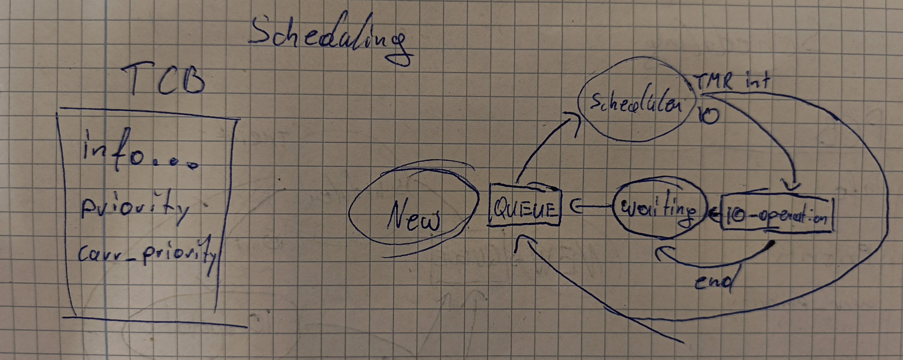

## Scheduler 

### Scheduler structure

For now, I'll implement a basic priority scheduler I thought up while in school\
The basic scheduling Idea is pretty much the same as in every other sched.

Each Thread is scheduled separately and has it's own TCB(Thread Control Block)\
Threads in the same process will either have the info as duplicates or a shared struct\

**Version A:**
  - Duplicate information
  - might be faster on direct access bc no second ptr has to be stored
  - better cache efficiency for frequent tasks????

**Version B:**
  - Race conditions keeping me up at night
  - Better memory efficiency in  kheap??

ok I'll leave this here but I'll choose v. A\
bc I js noticed, that I have to put a lock on the shared info\
well if I want to access values that might change (outside of context switch)

### Scheduler Priorities

**Some goals**
- The scheduler should be deterministic
- It should be easy to implement
- Not let a priority 0 thread have 2 contiguous turns 

Each task will have a priority 0 - n (0 is most significant)\
This will stay constant.\
A second value active prio changes to determine whether the task should be scheduled\
active prio inits w/ priority + 1

- step through the linked list of TCBs 
- check whether active prio == 0 (first wins)
  - if not decrement active prio and repeat w/ next
- on success set the active prio back to prio + 1
- then execute a context switch (I still have to work out the dets)
